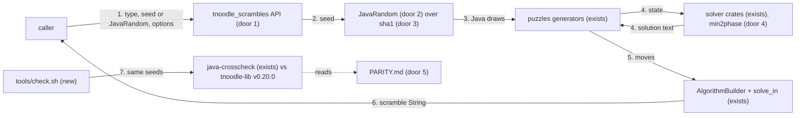

# Mirror cubes: Java-identical randomness, min2phase and seeded scrambles

**Approved**: 2026-11-21 - user: "approved, let's do /tlc-implement first for plan 1"

> Build this with **tlc-implement**. Every criterion becomes a check with a proof; nothing under
> the open questions is settled while building.

## Problem

tnoodle-rs presents itself as a Rust port of tnoodle-lib, but nobody can reproduce a tnoodle scramble
with it, and its 3x3 solver is not tnoodle's.

- There are no seeded scrambles. `generate_scramble` takes any `impl Rng`, so even a fixed seed does not
  give the scramble tnoodle gives for that seed. A competition tool cannot regenerate a tnoodle scramble
  set, and the Java cross-check can only check that a random-state scramble is valid, never that it is
  the same scramble.
- The 3x3 search (`crates/min2phase/src/search.rs`) is a simplified algorithm, not tnoodle's
  `Search`/`SearchWCA`. An audit on 2026-11-21 found: 3 of 6 URF orientations, no pre-moves, no
  `MAX_DEPTH2 = 12` cap, a different phase-1 stopping rule, no TwistFlip pruning, probe counts where
  tnoodle uses milliseconds, and no `USE_SEPARATOR`, `APPEND_LENGTH`, `OPTIMAL_SOLUTION`, `next()` or
  `numberOfProbes()`. Measured on 300 scrambles, Rust 3x3 scrambles average 20.5 moves against tnoodle's
  18.6. For the same facelets the two return different solutions.
- `Tools` is missing the constrained generators (`randomLastLayer`, `randomCrossSolved`, `superFlip`, and
  others), and `random_cube` draws differently from Java's `randomCube`.

Who pays: anyone using the crates as "tnoodle in Rust" (competition tooling, the cube timer app, ports
of Java code), and anyone trying to prove the port correct.

When this ships, a caller passes a seed and gets, for every non-deferred WCA event, exactly the scramble
tnoodle-lib v0.20.0 gives for that seed (with the two exceptions in AD-012 and AD-015), and the 3x3
solver returns the same text as tnoodle's for the same input.

## Shape

This reuses the existing min2phase tables (`cubie_cube.rs`, `coord_cube.rs`, `util.rs`, audited
line-for-line identical), the threephase, sq12phase and solver crates, and the Java cross-check in
`tools/java-crosscheck`. Every rule that decides a scramble (random draws, search order, pruning,
formatting) runs in the library crates, which `cargo test` and the cross-check reach directly.

1. caller -> `tnoodle_scrambles` public API (door 1) - `generate_scramble`, `generate_scrambles`,
   `generate_seeded_scramble`, `generate_seeded_scrambles`, `generate_scramble_with`, `generate_wca_scramble`
2. `JavaRandom` (door 2) - built from a seed with Sun `SHA1PRNG` semantics over the `sha1` crate (door 3),
   or self-seeded from OS entropy; hands Java `Random` draws (`next_int(bound)`, `next_bytes`, ...) to step 3
3. `puzzles` generators (exists) - one module per event in `crates/scrambles/src/puzzles/`; draw from `JavaRandom` in Java's
   order; random-turn events walk successors in Java's `LinkedHashMap` insertion order
4. `solver crates` (exists): `min2phase` `Search`/`SearchWca` (rewritten, door 4), `threephase`,
   `sq12phase`, `solvers` 2x2/Skewb/Pyraminx - return solution text
5. `AlgorithmBuilder` (exists) canonicalizes, and the WCA minimum-distance filter `solve_in` (exists)
   rejects states too close to solved
6. out: the scramble `String`
7. `tools/check.sh` (new) runs fmt, clippy, debug and release tests, and `java-crosscheck` (exists,
   re-pinned to `v0.20.0`), which feeds the same seeds and inputs to Java and Rust and diffs
   the outputs, honouring `PARITY.md` (door 5)

**Changes underneath**

| Front | What changes |
| --- | --- |
| domain | `generate_scramble(type, &mut impl Rng)` becomes `generate_scramble(type)`; randomness is only ever `JavaRandom` - the app's `rust/src/api/simple.rs` calls it today (2 call sites) |
| domain | `min2phase::search::Search::solution` changes signature and output text (Java's padded text, typed errors, verbose flags, budget) - called by `three_by_three.rs`, `threephase/src/search.rs:412` and the cross-check example |
| domain | `min2phase::tools::random_cube` / `random_state` draw like Java's `Tools.randomCube` - the randomness test and the cross-check call them |
| domain | `threephase` `Center1::getsym` returns the first matching symmetry and phase-1 candidates are tried in Java's `PriorityQueue` order - every 4x4 scramble may change |
| stored data | nothing stored |
| readers | the cube timer app (separate repo) keeps compiling only after its 2 call sites move to the new API; that happens on the user's go (AD-006), outside this plan |

Data: none - the library stores nothing; scrambles are computed per call.

## Surface

None - no HTTP routes. The consumed surface is the public Rust API, whose literal signatures are
Landing doors 1, 2 and 4. Every item anyone may call; how each one fails:

- `generate_scramble`, `generate_scrambles`, `generate_seeded_scramble`, `generate_seeded_scrambles`,
  `generate_scramble_with`, `generate_wca_scramble` - no error path; always return scrambles
- `JavaRandom::next_int_bounded` - `Err(InvalidBound)` for a bound <= 0, where Java throws
  `IllegalArgumentException`
- `min2phase::Search::solution`, `SearchWca::solution`, `Search::next` - `Err(SearchError)` carrying
  Java's code 1-9
- `min2phase::tools::from_scramble` - `Err(InvalidMove)` for a token that is not a move (AD-002)

## Landing

| One-way door | Literal shape | Alternative rejected |
| --- | --- | --- |
| 1. public randomness API (AD-009, AD-014) | `generate_scramble(PuzzleType) -> String`; `generate_scrambles(PuzzleType, usize) -> Vec<String>`; `generate_seeded_scramble(PuzzleType, &str) -> String`; `generate_seeded_scrambles(PuzzleType, &str, usize) -> Vec<String>`; `generate_scramble_with(PuzzleType, &ScrambleOptions) -> String`; `generate_wca_scramble(PuzzleType, &mut JavaRandom, &ScrambleOptions) -> String`; `pub struct ScrambleOptions { pub search_budget: SearchBudget }` with `Default` = Java; `pub enum SearchBudget { Time { min: Duration, max: Duration }, Probes { min: u64, max: u64 } }` | `&mut impl Rng` parameter - lets a caller draw randomness unlike Java, so a seed could not reproduce tnoodle |
| 2. `JavaRandom` type | one concrete type wrapping Sun `SHA1PRNG`; methods named after `java.util.Random` (`next_int_bounded(bound: i32) -> i32` etc.) and returning Java's values for the same seed bytes; the seed is the UTF-8 bytes of the `&str`, as Java's `String.getBytes()` with a UTF-8 default charset | a trait over several generators - a second implementation could not be Java-identical |
| 3. new dependency `sha1` (RustCrypto) (AD-013) | `sha1 = "0.10"` in the crate that owns `JavaRandom` | hand-written SHA-1 - crypto code we would have to test ourselves |
| 4. min2phase public API | `Search` and `SearchWca` structs mirroring Java's; `solution(...) -> Result<String, SearchError>`; `pub enum SearchError` with one variant per Java error 1-9 and `fn code(&self) -> u8` returning Java's number; `Verbose` flags type with `USE_SEPARATOR`, `INVERSE_SOLUTION`, `APPEND_LENGTH`, `OPTIMAL_SOLUTION`; output text byte-identical to Java (AD-016) | the current `SearchResult::{Solution, Error(i32)}` with negative codes - not Java's codes, no flags |
| 5. `PARITY.md` as a contract | `PARITY.md` at the repo root: one row per intentional difference (Java behaviour, Rust behaviour, decision id); the cross-check reads the same list and excludes exactly those cases | differences kept only in commit messages - the cross-check could not enforce them |
| 6. crate versions | every crate at `0.20.0` | keeping `0.1.0` - hides which tnoodle release it mirrors (AD-003) |

- Nothing else in this change is hard to reverse

## Criteria

### S1: Local gate pinned to v0.20.0 (P1)

One command proves a branch before it is pushed, against the tnoodle-lib release we mirror.

**Acceptance Criteria**

1. WHEN `tools/check.sh` runs on a clean tree THEN it SHALL run, in order, `cargo fmt --check`, `cargo clippy --workspace --all-targets`, `cargo test --workspace` (debug), `cargo test --workspace --release` and `tools/java-crosscheck/run.sh`, print one `PASS`/`FAIL` line per step, and exit `0` only when every step passed
   - all green → exit `0`; a formatting difference only → `fmt FAIL`, exit non-zero, later steps still reported
2. IF any step fails THEN `tools/check.sh` SHALL exit with a non-zero status and name the failing step in its last line
3. The Java cross-check SHALL build tnoodle-lib at tag `v0.20.0` (commit `d5ddbe6`) unless `TNOODLE_LIB` points elsewhere, and print that version on its first line
4. IF a cross-check case differs from Java and is not listed in `PARITY.md` THEN `run.sh` SHALL exit non-zero; IF it differs and is listed THEN it SHALL report it as `expected` and not fail

### S2: Java-identical randomness (P1)

`JavaRandom` produces the same numbers as Java's `SecureRandom.getInstance("SHA1PRNG", "SUN")` after `setSeed`.

**Acceptance Criteria**

5. WHEN `JavaRandom::from_seed(b"abc")` and Java's `SHA1PRNG` seeded with `"abc".getBytes()` each produce 1,000 `nextInt(bound)` values for bounds 1, 2, 3, 12, 40320, 479001600 and 2^31-1 THEN the sequences SHALL be identical
   - bound `2^k` (Java's power-of-two branch) and bound `3` (rejection branch) both match; seeds `""`, `"abc"`, a 1,000-byte seed and a non-ASCII seed `"ñandú"` all match
6. WHEN both produce 1,000 values each of `nextInt()`, `nextLong()`, `nextBoolean()`, `nextDouble()` and 37-byte `nextBytes` THEN the sequences SHALL be identical
7. IF `next_int_bounded` is called with a bound `<= 0` THEN it SHALL return an error and not panic
8. WHEN `JavaRandom::from_entropy()` is called twice THEN the two first `next_long()` values SHALL differ

### S3: min2phase is tnoodle's solver (P1)

For the same input, the Rust `Search` and `SearchWca` return Java's exact text.

**Acceptance Criteria**

9. WHEN Java's `Search.solution` and Rust's `Search::solution` get the same 1,000 random facelet strings with `maxDepth` 21, probe limits `(100000, 0)` and verbose `0` THEN the outputs SHALL be byte-identical
   - also identical with verbose `INVERSE_SOLUTION`, `USE_SEPARATOR`, `APPEND_LENGTH`, `OPTIMAL_SOLUTION` (maxDepth 13 on states 13 moves from solved) and their combinations; with probe limits `(100000, 2000)`
10. WHEN `SearchWca::solution` gets the same facelets with `probeMin = 0` and each of the axis restriction pairs (`R`,`F`), (`U`,`B`), (`L`,`L`), (`F`,`D`), (none,`F`), (`R`,none) THEN its output SHALL be byte-identical to Java's `SearchWCA.solution`, including the U/D last-axis check of `SearchWCA.java:123` (AD-002)
11. WHEN `Search::next` is called after a solution, with the same probe limits as Java THEN it SHALL return Java's next solution text, and `number_of_probes()` and `length()` SHALL equal Java's `numberOfProbes()` and `length()`
12. IF the facelets are invalid THEN `solution` SHALL return `SearchError` with Java's code
    - 53 characters → code 1; two centers swapped → Java's code for that input; a flipped edge → 3; a twisted corner → 5; odd parity → 6
13. IF no solution exists within `max_depth` THEN `solution` SHALL return code 7; IF the probe maximum is reached first THEN code 8; IF a restriction is not a face move THEN code 9
14. WHILE the budget is `SearchBudget::Time { min, max }` the search SHALL stop at the first probe after `min` has elapsed once a solution exists, and return code 8 when `max` elapses without one
    - default options for 333 → elapsed time per scramble ≥ 200 ms; `Probes { min: 0, max: 60000 }` → returns on the first solution
15. WHEN Java's `Tools` and Rust's `tools` are given the same seeded `JavaRandom` THEN `randomCube`, `randomLastLayer`, `randomLastSlot`, `randomZBLastLayer`, `randomCornerOfLastLayer`, `randomEdgeOfLastLayer`, `randomCrossSolved`, `randomEdgeSolved`, `randomCornerSolved` and `superFlip` SHALL return identical facelet strings, 500 calls each
16. WHEN `tools::from_scramble` gets a canonical scramble THEN it SHALL return Java's facelets; IF a token is not a valid move (`R2'`, `R3`, `Rw`, `RU`) THEN it SHALL return an error instead of Java's guessed move (AD-002, listed in `PARITY.md`)
17. The min2phase crate SHALL keep passing every existing test, and the 3x3 scramble length over 300 unseeded scrambles with default options SHALL average between 18.0 and 19.2 moves

### S4: Seeded scrambles equal tnoodle's (P1)

The same seed gives the same scramble as tnoodle-lib v0.20.0 for every non-deferred event.

**Acceptance Criteria**

18. WHEN Rust's `generate_seeded_scrambles(type, seed, 20)` and Java's `generateSeededScrambles(seed, 20)` run for seeds `"a"`, `"tnoodle"`, `"2026-11-21 round 1"` and `""` THEN the 20 scrambles SHALL be byte-identical for `222`, `444`, `444fast`, `555`, `666`, `777`, `444ni`, `555ni`, `minx`, `clock` and `sq1`
    - `minx` keeps Java's newlines; `444` covers the threephase `Center1` first-symmetry rule and Java's `PriorityQueue` order
19. WHEN the same comparison runs for `333`, `333ni` and `333fm` THEN Rust SHALL equal Java's scramble computed with the same seeded random state and `SearchWCA` at `probeMin = 0` (AD-012, listed in `PARITY.md`)
20. WHEN the same comparison runs for `skewb` and `pyram` THEN each Rust scramble SHALL reach the same puzzle state as Java's scramble for that seed, have Java's length, and be identical across two Rust runs (AD-015, listed in `PARITY.md`)
21. WHEN `generate_seeded_scramble(type, seed)` is called twice with the same arguments THEN it SHALL return the same string, for all 16 event types
22. WHEN `generate_scramble(type)` is called 2,000 times per event THEN every scramble SHALL pass the cross-check's Java judge (valid, not within the minimum distance, canonical for cube events), and the ignored `randomness` test SHALL still pass
23. The random-turn events (`444fast`, `555`, `666`, `777`) SHALL choose moves by Java's reservoir `choose` over the successors in Java's `LinkedHashMap` insertion order
24. The system SHALL have every crate at version `0.20.0`, and `CHANGELOG.md` SHALL list each removed or changed public item with the Java member it now mirrors

## Out of scope

| Excluded | Why |
| --- | --- |
| svglite, colour schemes, Megaminx/Clock models and SVG | plan `mirror-images` (AD-011) |
| ScrambleCacher listener/stop/counts, long names, `getPreferredSize(maxW,maxH)`, `PuzzleImageInfo` | the small-API-gaps plan (AD-011) |
| FTO | its own later plan (AD-011) |
| Pyraminx, Skewb and Square-1 puzzle models | deferred by the user |
| Updating the cube timer app to the new API | separate repo; moves only on the user's go (AD-006) |
| CI workflows | cost; `tools/check.sh` instead (AD-007) |

## Assumptions

| Assumption | Chosen default | Rationale | Confirmed? |
| --- | --- | --- | --- |
| How a `&str` seed becomes bytes | UTF-8 bytes, as Java's `String.getBytes()` on a UTF-8 default charset (Java 18+ default) | Java 17 on another default charset would differ only for non-ASCII seeds | n |
| `from_entropy` seed source | OS entropy through the `getrandom` crate already in the dependency tree via `rand` | Java's self-seeding is not reproducible either; only unpredictability matters | n |
| Where `JavaRandom` lives | a new small crate `tnoodle-random` that min2phase, threephase, sq12phase, solvers and scrambles all depend on | every solver crate draws from it, so it cannot live in `scrambles` | n |
| `check.sh` flags | none in this plan; seed and scale of the cross-check stay as `run.sh` defaults | keep the gate one command | n |

**Open questions:** none - all resolved or logged above.

## Differences from the source

| Source shows | Product shows | Confirmed |
| --- | --- | --- |
| Java seeded 333/333ni/333fm search for at least 200 ms, so a seed's 3x3 text depends on machine speed | seeded 3x3-family scrambles use `probeMin = 0` and are reproducible | y - AD-012 |
| Java Skewb/Pyraminx solvers order moves with an unseeded `new Random()` | the move order is drawn from the seeded stream, so Rust is reproducible | y - AD-015 |
| Java `Tools.fromScramble` guesses a move for an invalid token (`R2'` → `F`) | an error | y - AD-002 |
| Java returns `"Error N"` strings, `null` and checked exceptions | `Result` with typed errors carrying Java's codes; the solution text itself is unchanged | y - AD-001, AD-016 |
| Java `generateScramble(Random)` accepts any `Random` | only `JavaRandom` | y - AD-009 |

## Sources

- Grilling session with the user, 2026-11-21 - binding - AD-001 to AD-016 in `.specs/STATE.md`
- Module audits of min2phase, threephase, sq12phase + svglite and the scrambles core, 2026-11-21 - binding - the divergences this plan closes
- tnoodle-lib tag `v0.20.0` (`d5ddbe6`), https://github.com/thewca/tnoodle-lib - binding - the reference behaviour
